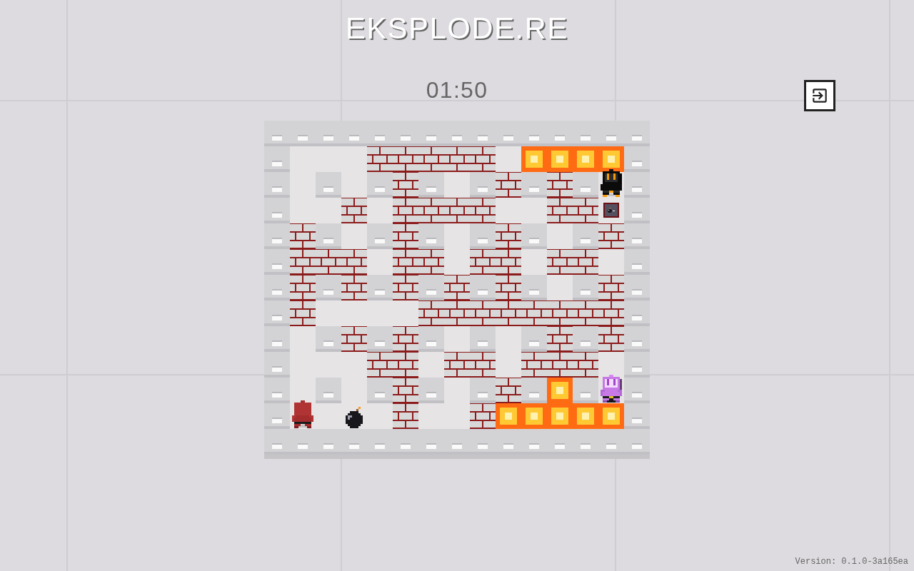
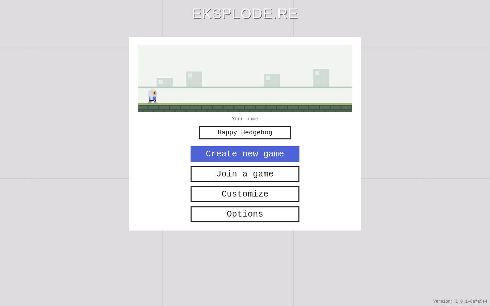
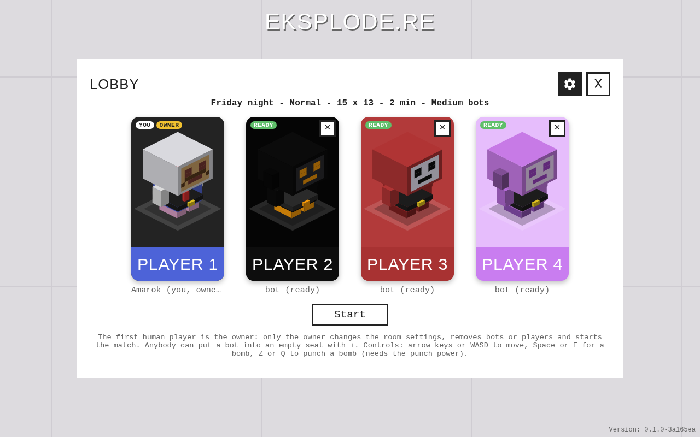
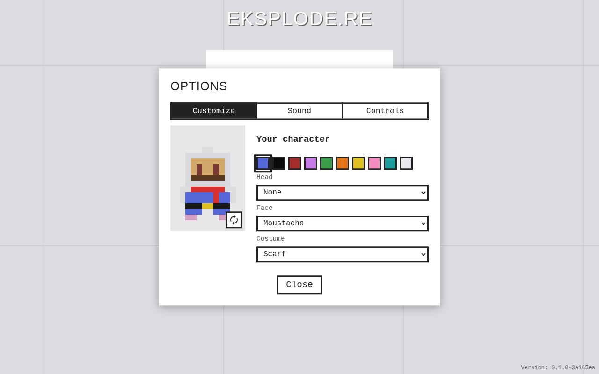
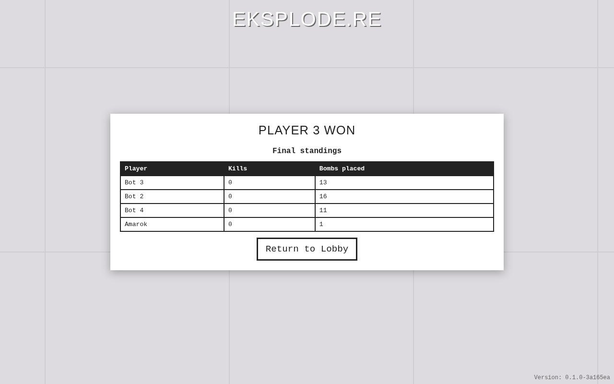

# Eksplode.re

[](https://github.com/AmarOk1412/Eksplode.re/actions/workflows/ci.yml)

[Donate on Buy Me a Coffee](https://buymeacoffee.com/kaelinnchacuit)

Note: This is a "Toy project" fully sloppy generated.

Four-player Bomberman in Rust. Play in a terminal or in a web page, add bots, and let browser and
terminal players share the same match. The rules, the bots, the network protocol and the
pixel-art view are all small, tested crates.



| | |
|---|---|
|  |  |
| Pick a name and jump in. | The lobby: empty seats fill with bots, the owner starts. |
|  |  |
| Dress your character up (or let the dice decide). | Who won, who blew up whom. |

## Features

- Four players per match: any mix of people (terminal or browser) and bots.
- **Animated main menu:** side-view runners drop bombs, cross paths in the foreground/background,
  ride karts, and get caught in occasional cartoon mishaps. No scene controls are shown;
  reduced motion uses a still image. These silent scenes never
  affect rooms, readiness, or gameplay.
- **Revenge karts:** eliminated Normal/Team players drive around the perimeter and throw inward until walls start closing. Direct hits stop movement for one second; eliminating an opponent with a current kart bomb earns a return to the board. Chaser rules are unchanged.
- **Rooms and modes:** the owner of a room chooses the mode (Normal, Team, Chaser), the board size (small,
  medium, large), the round time (2, 3, 5 or 10 minutes), for Team friendly fire, and the bot
  difficulty (Easy, Medium or Hard; Medium by default), on a creation menu (page) or setup screen
  (terminal). In Normal and Team rounds the board closes in during the
  last minute until one player or team is left; see [docs/GAMEPLAY.md](docs/GAMEPLAY.md).
- **Web page** with a top-down pixel-art view: four characters (blue, black, red, purple),
  grey pillars, red-brick blocks, bombs and flames, a round timer and tall lobby cards with
  animated isometric 3D characters, all drawn by a Rust module compiled to WebAssembly. The page
  opens on a main menu (Create new game, Join a game, Customize, Options); Customize picks colour, head, face and costume (or randomizes them with the
  icon on the preview) and Options has Sound and Controls tabs. Empty lobby seats fill with bots: the owner removes a bot or kicks a
  player with the cross on a seat, anybody puts a bot back with "+", and room settings and the
  password live behind the gear icon.
- **Terminal version** for local play on one keyboard, with a lobby screen.
- **Network play:** an authoritative host, `join` by address, or a server that hosts the match
  and serves the web page.
- Bots that flee flames, collect power-ups, hunt opponents and dig through blocks, each with a
  behaviour drawn at the start of every match (Aggressive, Protective or Balanced) and the room's
  difficulty.
- Deterministic rules: the same seed and inputs always give the same match.
- Safe defaults: loopback bind, same-origin WebSockets, hard limits on all external input.

## Quick start

You need [Rust](https://rustup.rs/). The WebAssembly module is committed, so nothing else is
required.

```sh
cargo build --workspace                                   # 1. build everything
cargo run -p eksplode-re-web -- --bind 127.0.0.1 --bots 1  # 2. start a local server
# 3. open http://127.0.0.1:8080/, create a room, enter your name, then Start
cargo run -p eksplode-re-cli -- join 127.0.0.1              # 4. select the room in the terminal directory
cargo test --workspace                                    # 5. run the tests
```

The creator owns their room and starts its match (Enter or the Start button). Other players
select that room from the directory; each room manages its own four participants and settings.
Prefer to host from the terminal? `cargo run -p eksplode-re-cli -- host --bots 1 --web-port 8080`
does the same and lets browsers join too.

## Install on Linux

Ubuntu/Debian examples; use the equivalent packages on other distributions. Install Rust stable
from [rustup](https://rustup.rs/) first. The committed WASM needs no browser build toolchain.

```sh
sudo apt update
sudo apt install -y build-essential pkg-config git
git clone https://github.com/AmarOk1412/Eksplode.re.git
cd Eksplode.re
cargo +stable build --release --locked -p eksplode-re-web -p eksplode-re-cli
./target/release/eksplode-re-server --bind 127.0.0.1
```

Open `http://127.0.0.1:8080/`. The terminal client is `./target/release/eksplode-re-cli`.
For a local installation, put the two release binaries on your PATH. Rebuild and replace the
server binary after updates: its HTML, JavaScript, PNG and WASM are embedded in the executable.

### Run as a service

For a public browser deployment, point a DNS name such as `play.example.com` at the host. The
following example uses a dedicated user, loopback listeners, 100 rooms and a 1,024-connection
ceiling; those limits include directory/HTTP connections, not only active players.

```sh
sudo useradd --system --home /var/lib/eksplode-re --shell /usr/sbin/nologin eksplode-re
sudo install -d -o eksplode-re -g eksplode-re /var/lib/eksplode-re
sudo install -m 0755 target/release/eksplode-re-server /usr/local/bin/eksplode-re-server
```

Create `/etc/systemd/system/eksplode-re.service`, substituting your real hostname:

```ini
[Unit]
Description=Eksplode.re game server
After=network.target

[Service]
User=eksplode-re
WorkingDirectory=/var/lib/eksplode-re
ExecStart=/usr/local/bin/eksplode-re-server --bind 127.0.0.1 --http-port 8080 --game-port 7878 --allow-origin https://play.example.com --max-rooms 100 --max-connections 1024
Restart=on-failure
RestartSec=3
LimitNOFILE=16384
TasksMax=2048
NoNewPrivileges=true
PrivateTmp=true
ProtectSystem=strict
ProtectHome=true

[Install]
WantedBy=multi-user.target
```

Enable it with `sudo systemctl daemon-reload && sudo systemctl enable --now eksplode-re`.
Inspect logs with `journalctl -u eksplode-re`. Do not expose ports 8080 or 7878 publicly; the
unencrypted terminal transport is for a private network/VPN. Do not enable `--allow-any-origin`.

### nginx and HTTPS

```sh
sudo apt install -y nginx certbot python3-certbot-nginx
```

Put this in `/etc/nginx/sites-available/eksplode-re`; the `map` belongs in nginx's `http`
context, as Debian's included site files do. Change the hostname to your DNS name.

```nginx
map $http_upgrade $connection_upgrade {
  default upgrade;
  '' close;
}

server {
  listen 80;
  server_name play.example.com;

  location / {
    proxy_pass http://127.0.0.1:8080;
    proxy_http_version 1.1;
    proxy_set_header Host $host;
    proxy_set_header Upgrade $http_upgrade;
    proxy_set_header Connection $connection_upgrade;
    proxy_set_header X-Forwarded-Proto $scheme;
    proxy_set_header X-Real-IP $remote_addr;
    proxy_read_timeout 65s;
    proxy_send_timeout 65s;
    proxy_buffering off;
  }
}
```

```sh
sudo ln -s /etc/nginx/sites-available/eksplode-re /etc/nginx/sites-enabled/eksplode-re
sudo nginx -t && sudo systemctl reload nginx
sudo certbot --nginx --redirect -d play.example.com
sudo certbot renew --dry-run
```

Allow public TCP 80/443 in the host/cloud firewall and keep 80 reachable for certificate renewal.
Certbot needs working public DNS and will ask for the certificate account details locally. Open
`https://play.example.com/` after TLS is installed; the configured HTTPS origin permits its WSS
connection. Before that, the HTTPS-only origin setting intentionally does not permit an HTTP
browser game. Check the distribution's certbot renewal timer is enabled.

## Hosting resources

Measured on 2026-11-06: Intel i7-13700H, 20 logical CPUs, about 31 GiB RAM, Linux, Node 22,
release Rust server. Workload: WebSocket loopback, Normal 15x13 boards, four humans per room,
movement inputs, no bombs/bots, two-second warmup and 15-second observation. Server RSS/CPU
exclude the load generator, nginx, TLS, OS/kernel socket memory and browser rendering. These
are short light-workload measurements, not production guarantees or worst-case game costs.

The 400-player run used 408 server threads and 407 descriptors. Check service/container task,
user-process, descriptor and kernel limits as well as RAM/CPU; raising those limits alone does
not establish the unsuccessful 4,000-player target.

| Target players | Rooms / instances | Server CPU cores used | Server RSS | Payload egress | Update-rate result |
|---|---|---:|---:|---:|---|
| 4 | 1 / 1 | 0.026 | 5.0 MiB peak | 2.24 Mbps | 20 Hz; all four active |
| 400 | 100 / 1 | 1.55 | 99.1 MiB peak | 224.2 Mbps | 20 Hz median; 19.93 Hz p05; all 400 active |
| 4000 | 1000 / 8 attempted | No valid steady-state result | About 899 MiB aggregate high-water during failed setup | Not certified | Setup timed out after 3,876 admissions; disconnects; target not met |

The 4,000-player attempt used eight independent generators/backends; failed/partial observation
windows must not be summed into a claimed 4,000-player capacity. Full machine/workload/shard
results are in [docs/hosting-measurements.json](docs/hosting-measurements.json). A single-generator
attempt also failed. The cause has not been isolated to server, generator or host limits.

**Starting budgets, estimates only:** for four players, 1 vCPU / 1 GiB host RAM / 10 Mbps; for
400, 4 vCPU / 2 GiB / at least 500 Mbps; for 4,000, roughly 32-40 vCPU / 8-20 GiB / at least
5 Gbps aggregate across multiple hosts/instances is an initial extrapolation with headroom,
**not a validated capacity recommendation**. Large boards, bots, bomb effects, TLS and cold
asset downloads need separate testing. A cold page is under 500 KiB, so 4,000 simultaneous first
visits can add nearly 2 GiB of downloads before steady gameplay traffic.

The CLI allows at most 128 rooms and 1,024 connections per process: at four humans per room,
one process supports at most 512 active seats, with directory connections needing spare capacity.
Defaults are only 32 rooms/256 connections. Prefer no more than the measured 400 players per
instance while evaluating larger deployments. Independent backends have independent rooms;
give each a dedicated hostname/origin (for example `play1.example.com`, `play2.example.com`).
Do not round-robin a single origin's directory HTTP and WebSocket requests across different
backends: clients can see room identities belonging to the wrong server. Automatic cross-server
room aggregation is not implemented.

Reproduce on the target Linux host, with Node 22 and free ports 18080-19580:

```sh
cargo +stable build --release --locked -p eksplode-re-web
node scripts/host-load.mjs --players 4,400,4000 --seconds 15 --output /tmp/hosting-results.json
```

The harness creates/stops its own loopback servers and real four-human matches; workloads above
512 players use a generator/backend per shard. Run away from production traffic. Monitor CPU,
RSS, descriptors, disconnects and low-percentile snapshot rate on the actual machines with
nginx/TLS and realistic gameplay before promising a capacity. This guide's nginx/certbot examples
were not deployed on the measurement machine.

## Modes

| Mode | Command | What it is |
|------|---------|-----------|
| Terminal host | `cargo run -p eksplode-re-cli` | the default: host a match on port 7878 and play in it |
| Terminal host (explicit) | `cargo run -p eksplode-re-cli -- host --bots 1` | same as above, named explicitly, with options |
| Local | `cargo run -p eksplode-re-cli -- local --players 2 --bots 2` | up to four people share one keyboard, bots fill the rest; shows the lobby screen first |
| Local, instant start | `cargo run -p eksplode-re-cli -- local --instant` | skip the lobby screen and start right away |
| Terminal host with the page | `cargo run -p eksplode-re-cli -- host --web-port 8080` | the same match, joinable from browsers |
| Server | `cargo run -p eksplode-re-web -- --bots 1` | headless host plus the web page; nobody has to sit at it |
| Join | `cargo run -p eksplode-re-cli -- join 192.168.1.20` | a terminal player joins a host or server |

### Terminal options

`eksplode-re-cli [OPTIONS]` with no subcommand defaults to `host` (see below) so a bare run is
ready for others to join. `eksplode-re-cli local [OPTIONS]` plays on this machine only, no network:

- `--players <N>` local human players, 0 to 4 (default 1);
- `--bots <N>` bots, 0 to 4 (default: fill up to 4 participants);
- `--seed <U64>` fixes the random generator;
- `--lobby` shows the lobby screen first (Up/Down select, `h` human, `b` bot, Enter start) —
  this is the default; `--instant` skips it and starts the match immediately instead;
- `--mode <normal|team|chaser>`, `--size <small|medium|large>`, `--time <2|3|5|10>` (minutes) and
  `--friendly-fire <on|off>` set the room settings of the match (defaults: normal, small, 3, on);
- `--p1-keys`, `--p2-keys`, `--p3-keys` and `--p4-keys` configure each local player's six keys in
  `up,down,left,right,bomb,punch` order; for example, `--p1-keys "w,s,a,d,e,z"`. Values accept
  single characters or `Up`, `Down`, `Left`, `Right`, `Space`. Omitted slots keep their defaults;
  duplicate keys and `q` (quit), `p` (pause) or `r` (rematch) are rejected;
- `-h`, `--help` and `-V`, `--version`.

`eksplode-re-cli host [--port N] [--bots N] [--name NAME] [--seed N] [--web-port N] [--bind IP] [--dev]
[--room-name TEXT] [--mode M] [--size S] [--time MIN] [--friendly-fire on|off] [--no-setup]
[--bot-difficulty easy|medium|hard]`
(the `host` keyword is optional — this is also what a bare `eksplode-re-cli` runs):

- `--port <N>` game port (default 7878), `--bots <N>` bots from 0 to 3, `--name <NAME>` your
  name (1 to 16 printable characters), `--seed <N>` fixed seed;
- `--web-port <N>` also serve the web page on this port;
- `--server-id <ID>` stable ASCII host identifier, 1 to 64 characters; `--max-rooms <N>` limits
  simultaneous rooms to 1-128 (default 32), and `--max-connections <N>` sets the shared host
  connection cap to 4-1024 (default 256);
- `--room-name <TEXT>` names the room (at most 24 characters), and `--mode`, `--size`, `--time`,
  `--friendly-fire` and `--bot-difficulty <easy|medium|hard>` (default medium) set it as above;
  without any of them the host first shows a room setup screen
  (Up/Down select, Left/Right change, type the name, Enter on "Create room"), which `--no-setup`
  skips. In the lobby the owner changes the settings with `m` mode, `s` size, `t` time, `f`
  friendly fire and `d` bot difficulty; everybody sees them. Only the host chooses the bot
  difficulty: local games keep Medium;
- `--dev` developer mode (testing only): the owner can pause bots, force the behaviour of the bots
  created from then on and set drop chances from the web page; see [docs/WEB.md](docs/WEB.md);
- `--bind <IP>` listening address. By default the game port listens on every interface and the
  page only on `0.0.0.0`; a non-loopback address prints a `WARNING:`. See
  [docs/SECURITY.md](docs/SECURITY.md).

`eksplode-re-cli join <ADDR[:PORT]> [--name NAME] [--keys KEYS] [--room-id ID]` opens a host's
directory without joining a room. Select a room or press `c` to create one; `--room-id` explicitly
selects a known 32-character lowercase hexadecimal room ID on that host. `--keys` uses the
same six-key order for the joining player only. `host`, `host:port` and web addresses such as
`http://host:8080/` work; for a web address only the host is kept. A refused or full match ends
with a one-line explanation and exit status 1.

The terminal must be at least 40x22; a medium board needs 44x24 and a large one 56x28, including the fixed kart gutter (the game says so when the terminal is too small). Wrong usage exits with status 2.

### Server options

`eksplode-re-server` (`cargo run -p eksplode-re-web --`) takes `--bind`, `--http-port`,
`--game-port`, `--bots`, `--seed`, `--allow-origin`, `--allow-any-origin`,
`--max-connections`, `--max-rooms`, `--server-id`, `--dev` and the room defaults of the creation menu (`--room-name`, `--mode`,
`--size`, `--time`, `--friendly-fire`); the table and examples are in [docs/WEB.md](docs/WEB.md).

## Controls

In a kart, existing left/right controls drive counterclockwise/clockwise around the board, releasing stops, and the bomb action throws inward toward square two. Up/down and punch do nothing; opposing left/right holds are neutral. Team friendly fire also governs direct-hit stun. A return resets powers, not statistics or outstanding bombs. Karts disappear at the first closing warning; they never postpone the existing winner/draw result. See [docs/GAMEPLAY.md](docs/GAMEPLAY.md#revenge-karts).

| Where | Move | Bomb | Punch |
|-------|------|------|-------|
| Browser keyboard | arrows or WASD | Space or E | Z or Q |
| Mobile browser (portrait) | bottom-left joystick | bottom-right Bomb | bottom-right Punch, when powered |
| Mobile browser (landscape) | existing horizontal layout | existing action layout | Punch only when powered |
| Xbox-compatible controller | left stick or D-pad | A | B |

On a touch-capable phone, including Firefox for Android, portrait play uses a joystick at the bottom left and bomb/power actions at the bottom right. Punch appears only while your player has the Punch power. If you rotate to landscape, the existing horizontal control layout remains in use. The game does not force an orientation change.

After a round, the scoreboard ranks the players by survival (the winner or last survivor first, then the others in reverse order of elimination; ties by kills, then slot) and shows only Player, Kills and Bombs placed. It remains until Return to Lobby is selected.

Every browser screen is also keyboard/controller navigable: Tab and Shift+Tab move focus, arrows move between choices, Enter or Space activates, and Escape opens or backs out of the menu hub.
| Terminal P1 | arrow keys | Space | Z |
| Terminal P2 | W A S D | E | C |
| Terminal P3 | I J K L | O | U |
| Terminal P4 | T F G H | Y | N |

In the lobby: Enter starts (owner only), `b` adds a bot, `x` removes one, `r` toggles ready, `q`
quits. In a local match `p` pauses and `r` starts a rematch after a round. The terminal reports
no key releases, so a direction key moves one tile per tap and keeps moving while the key
repeats. In the browser the game keeps moving while a key is held.

Open the keyboard icon in the browser header to reassign any action, see the active bindings or
restore defaults. A reassignment replaces that action's aliases and is saved on the same device.
Conflicting and reserved keys are refused. For a controller, focus the visible game page and press
a button or move a stick if it is not listed yet; choose among listed controllers in the panel.
Movement uses the left stick or D-pad, A places a bomb and B punches a bomb. Keyboard input remains
available when a controller is disconnected or unsupported. See [docs/WEB.md](docs/WEB.md) for
browser setup details.

Every browser screen is also keyboard/controller navigable: Tab and Shift+Tab move focus, arrows
move between choices, Enter or Space activates, and Escape opens or backs out of the menu hub.
Controller D-pad or left stick moves focus, A activates, B goes back, and Start opens or closes the
hub. Activate a focused text field with A to enter text through the on-screen keyboard; its B or
Cancel action restores the original text. The hub provides Sound, Controls, Resume and, in developer
mode, Developer. Navigation panels suppress match input until they close. See
[docs/WEB.md](docs/WEB.md) for screen-by-screen details.

## Rules in short

Bombs explode after 3 s in a cross, stop at walls and destroy the first block, trigger other
bombs they reach, and eliminate every player on a burning tile. Blocks may hide power-ups:
extra bomb, roller (faster), flame (longer range), a rare punch and a kick that pushes bombs
until they hit something, but also maluses (slow, hyper speed, small bomb, auto bomb) that last 10 s. Every
power has a pixel-art icon and players turn and walk as they move. See [docs/GAMEPLAY.md](docs/GAMEPLAY.md). The web page has generated sound effects and music with a
volume panel (no audio files; see [docs/AUDIO.md](docs/AUDIO.md)). The last player alive wins; a round
without a survivor, or lasting more than 3 minutes, is a draw. With a single player the round
is a practice round that ends when that player dies.

## Bots

Bots take any slot that is not a person. They see exactly what a human sees (the public
observation) and act through the same input type. When a match starts each bot draws a
behaviour: **Aggressive** (hunts opponents first and from farther away), **Protective** (collects
power-ups and digs first, keeps its distance and only fights opponents that come close) or
**Balanced** (a mix of both). The room's bot difficulty, chosen by the owner, sets how fast they
react and how often they slip: **Easy** bots decide slowly, notice new bombs late and make
regular mistakes, **Medium** bots (the default) are a little slower with a few mistakes, **Hard**
bots react at once and make none. No bot ever steps into fire on purpose. Check them with:

```sh
cargo test -p eksplode-re-bots
cargo test -p eksplode-re-bots --test soak -- --nocapture   # 100 four-bot matches, escape rate,
                                                            # behaviour and difficulty statistics
```

## Network play and safety

The host is authoritative: it runs the simulation, validates every message and sends each
player its own view 20 times per second. If a player disconnects or stays silent for 10 s, a
bot takes the slot and the match goes on; if the host leaves, everybody is told.

**There is no encryption and no authentication.** The server listens on `0.0.0.0` by default;
only expose it on a network you trust, or behind a firewall, an SSH tunnel or a TLS reverse
proxy. WebSocket connections from other web origins are refused unless you opt in with
`--allow-origin` (or the unsafe `--allow-any-origin`). Messages over 64 KiB are refused and a
connection that sends ten bad messages is closed. The details are in
[docs/SECURITY.md](docs/SECURITY.md) and the wire format in [docs/PROTOCOL.md](docs/PROTOCOL.md).

## Repository map

| Path | Contents |
|------|----------|
| `crates/core` | pure rules: arena, bombs, step, lobby, observation |
| `crates/bots` | the default bot, danger map and path finding |
| `crates/net` | wire protocol, authoritative host, client |
| `crates/cli` | the terminal game, `host` and `join` |
| `crates/web` | `eksplode-re-server`, the HTTP and WebSocket server, and the page (`assets/`) |
| `crates/web-render` | the pixel-art view, compiled to WebAssembly |
| `docs/` | the guides below |
| `scripts/` | `build-wasm.sh`, `pty-enter-check.py`, `browser-smoke.mjs`, `check-scenarios.sh` |

## Documentation

- [Architecture](docs/ARCHITECTURE.md): how the parts fit together and how a key press travels.
- [Protocol](docs/PROTOCOL.md): every message, error code and limit.
- [Web server and page](docs/WEB.md): options, routes, origin policy, the WebAssembly module.
- [Security](docs/SECURITY.md): what is and is not protected, and how to host safely.
- [Development](docs/DEVELOPMENT.md): build, test, gates, commits and how to extend the game.

## Contributing

Enable the commit hook once per clone: `git config core.hooksPath .githooks`. Commit subjects
follow `part: short desc` (at most 80 characters) followed by a body that explains the change.
Parts: `core`, `bots`, `net`, `cli`, `web`, `render`, `build`, `docs`, `test`. Before merging run
`cargo fmt --check`, `cargo clippy --workspace --all-targets -- -D warnings` and
`cargo test --workspace`; see [docs/DEVELOPMENT.md](docs/DEVELOPMENT.md) for the full list.
