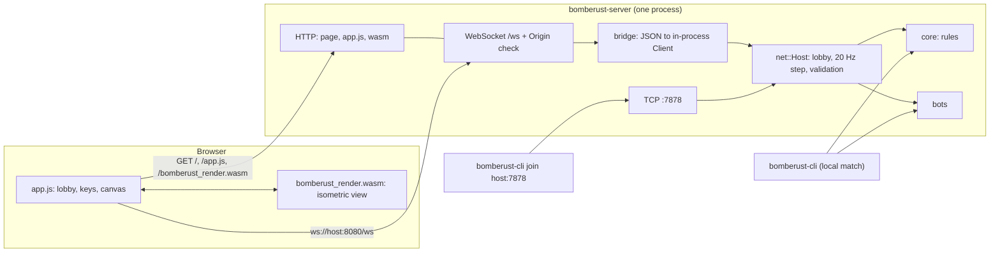
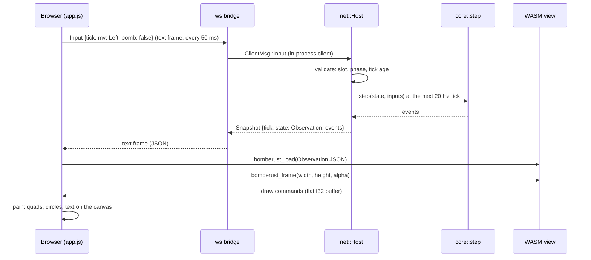

# Architecture

Bomberust is a four-player Bomberman. People play in a terminal or in a web page, computers play
as bots, and everybody can share one match. This page explains how the parts fit together and
where to change things.

## Principles

1. **The rules live in one place.** `core` is pure Rust: no I/O, no clock, no global state. The
   game advances by calling `step` once per tick with one input per player. The same seed and
   inputs always give the same match (determinism), which is what makes bots, tests and network
   play agree.
2. **Clients are thin.** The terminal and the browser only read keys, send inputs and draw what
   the host tells them. Neither evaluates rules.
3. **The host is authoritative.** One process runs the simulation, validates every message and
   sends each participant its own view.
4. **One protocol, two transports.** A terminal client talks newline-delimited JSON over TCP; a
   browser talks the same messages in WebSocket text frames. A bridge inside the server turns a
   WebSocket into an in-process client, so the host cannot tell them apart.
5. **Safe by default.** Loopback bind, same-origin WebSockets, hard limits on every external input.
   See [SECURITY.md](SECURITY.md).

## Components

| Crate | Depends on | Role |
|-------|-----------|------|
| [`core`](#core) | nothing | rules, arena, lobby, observation |
| [`bots`](#bots) | `core` | computer players |
| [`net`](#net) | `core`, `bots` | wire protocol, authoritative host, client |
| [`cli`](#cli) | `core`, `bots`, `net`, `web` | terminal game, `host` and `join` |
| [`web`](#web) | `core`, `net`, `bots` | HTTP and WebSocket server, `bomberust-server` |
| [`web-render`](#web-render) | `core` | isometric view compiled to WebAssembly |

### `core`

Pure rules in [`crates/core`](../crates/core).

- `Config` (arena size, timings, tick rate), `Arena` (tiles: floor, wall, block), `Pos`, `Dir`.
- `GameState::new(config, seed, active)` builds a round; `step(&mut state, &inputs)` advances it by
  one tick and returns the `Event`s that happened. Order inside a tick: cooldowns, flame and fuse
  timers, moves (with rotating priority so nobody is favoured), bomb placement, detonations with
  chain reactions, eliminations, end-of-round check.
- `PlayerInput` (`mv: Option<Dir>`, `bomb: bool`), `PlayerId` (slot 0 to 3), `Outcome`
  (`Winner(slot)` or `Draw`).
- `Observation` is the public view (`GameState::observe(me)`): no random generator and no
  power-ups still hidden under blocks. Bots and the render module consume only this.
- `Lobby` and `Controller` (`Local`, `Remote`, `Bot`, `Empty`) describe who holds each slot; the
  lobby owner is the lowest slot held by a person.

### `bots`

[`crates/bots`](../crates/bots) holds `DefaultBot`, which implements the `Bot` trait: given an
`Observation`, return a `PlayerInput`. It builds a `DangerMap` (where flames will be, including
chain reactions), finds paths with `find_path`, flees fire, collects power-ups, hunts opponents,
digs through blocks and only drops a bomb when it has a way out. A bot sees exactly what a human
sees.

### `net`

[`crates/net`](../crates/net): `protocol` (messages, see [PROTOCOL.md](PROTOCOL.md)), `codec`
(line framing with a 64 KiB limit), `Host` and `Client`.

`Host::start` binds a TCP port and spawns an accept loop plus one coordinating thread that owns
the lobby and the game state. Every connection has a reader thread that decodes messages and
sends them over a channel to the coordinator, and a writer thread that sends messages back, so
a slow client never blocks the match. The coordinator runs the 20 Hz tick: gather the latest
input of each slot (bots decide from their `Observation`), call `core::step`, send every
connected client a `Snapshot` of its own view, announce `Ended`, and return to the lobby.
`HostHandle::connect` attaches an in-process client without TCP; the local terminal player and the
WebSocket bridge use it.

Disconnects: a closed connection or 10 s of silence during a match hands the slot to a bot and
tells the others (`PlayerLeft`). In the lobby the slot is freed.

### `cli`

[`crates/cli`](../crates/cli) is the terminal front end (`ratatui`).

- `args` parses the command line; `input` turns terminal key events into inputs (every kind of
  Enter, including LF and Ctrl+J, counts as Enter); `view` draws the arena; `lobby` is the local
  lobby screen.
- `app::Session` is a local match: keys and bots feed `core::step` directly.
- `online::Online` is a host or client session: it applies server messages to a view and sends
  keys as `Input`. `app::run_host` starts a `net::Host`, and with `--web-port` also a
  `web::Server::attach`ed to the same host, so terminal and browser players share one match.

### `web`

[`crates/web`](../crates/web) is the backend of the web page and the `bomberust-server` binary.

| Module | Role |
|--------|------|
| `args`, `options` | command-line options and the `ServerOptions` they produce |
| `http` | a small HTTP/1.1 server with strict limits; routes the five fixed paths |
| `assets` | the page files embedded in the binary |
| `origin` | the `Origin` check and the start-up warnings |
| `ws` | the WebSocket bridge: one browser tab is one in-process client of the host |
| `addr` | the start-up banner and the addresses it prints |
| `lib` | `Server::start` (owns a host) and `Server::attach` (shares someone else's host) |

The page itself is in `crates/web/assets`; see [WEB.md](WEB.md).

### `web-render`

[`crates/web-render`](../crates/web-render) holds every graphics decision as safe, natively
testable Rust: `iso` (tile to screen projection), `depth` (painter's-algorithm order), `cube`
(three-face boxes and brightness), `interp` (smooth motion between ticks), `commands` (the flat
draw list). Only `ffi.rs` uses `unsafe` (allocate, free, expose the buffer) so the module can
exchange memory with JavaScript without generated glue. It compiles to
`bomberust_render.wasm`, which is committed so that nobody needs a WebAssembly toolchain to play.

## The life of a key press

A terminal client takes the same path without the bridge and the WASM step: its reader thread
decodes the JSON line, and `ratatui` draws the `Observation` as text.

## Lobby ownership and starting

The owner is the lowest slot held by a person. Only the owner may send `Start`, `AddBot` and
`RemoveBot`; anybody else gets `Error{NotOwner}` naming the owner, and the page or terminal shows
it. With the headless server nobody sits at the host, so the first person to join is the owner.

## Testing strategy

| Where | What |
|-------|------|
| `crates/core/tests` | rules: arena, movement, bombs, chains, power-ups, round end, determinism |
| `crates/bots/tests` | behaviour, danger map, path finding, parity with human inputs, a soak run of many matches |
| `crates/net/tests` | codec, lobby rules, loopback matches, latency and agreement on the result |
| `crates/cli/tests` | arguments, key mapping, lobby, online sessions, join errors, a real pseudo-terminal check of Enter |
| `crates/web/tests` | routes and headers, origin policy, WebSocket flows, mixed browser and terminal matches, shutdown, documentation |
| `crates/web-render/tests` | projection, depth order, cubes, interpolation, commands, the FFI |
| `crates/web/js-tests` | `node --test`: helpers of `app.js` and the compiled wasm module |
| `scripts/browser-smoke.mjs` | a real headless browser joins, starts and plays |

Tests come first: a rule or behaviour gets a failing test before its code.

## Extension points

- **A rule or a power-up:** add the behaviour to `core` with a test in `crates/core/tests`; the
  step order is documented above. Bots, the terminal and the web view need changes only if the
  rule adds something to the `Observation`.
- **A bot behaviour:** extend `DefaultBot` (or implement `Bot`) and add a case to
  `crates/bots/tests`; run the soak test.
- **A protocol message:** add a variant in `protocol.rs`, handle it in the host, document it in
  [PROTOCOL.md](PROTOCOL.md); the docs test fails until it is documented. New messages are
  additive and keep protocol version 1.
- **A screen or notice in the page:** add a case to `reduce` in `app.js` with a test in
  `crates/web/js-tests`, then render it.
- **A graphical change:** edit `web-render`, run its tests, rebuild the wasm
  (`./scripts/build-wasm.sh`) and commit the artifact.

See [DEVELOPMENT.md](DEVELOPMENT.md) for the workflow.
